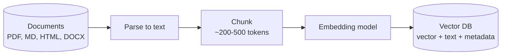
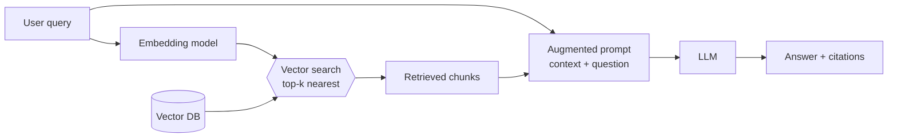

# Intro to RAG - Retrieval Augmented Generation

An LLM only knows what it saw during training. Ask it about your company's IT security policy, last week's incident report, or the VPN setup guide your team wrote yesterday, and you get one of two bad outcomes: "I don't have information about that", or worse - a confident, fluent, completely invented answer.

**Retrieval Augmented Generation (RAG)** is the standard fix. Instead of teaching the model new facts, you *look the facts up* at question time and paste them into the prompt.

## Why not just fine-tune the model?

Fine tuning a model can be a heavy task. You need a lot of labeled data, and you have to retrain the model every time your knowledge changes. RAG is much lighter: you can add or remove documents without retraining, and you can use the same model for multiple knowledge bases.

Fine-tuning changes *how* the model behaves (tone, format, task style). RAG changes *what* the model knows. Most "the bot doesn't know our stuff" problems are RAG problems.

## The core idea

RAG has two phases: an **offline indexing** phase that runs when documents change, and an **online retrieval** phase that runs on every user query.

### Phase 1: Indexing

You cannot paste a 4000-page PDF into a prompt. So you cut documents into **chunks**, convert each chunk into a **vector embedding**, and store the vectors in a **vector database** alongside a pointer back to the original text.



An **embedding** is a fixed-length list of numbers that represents the *meaning* of a piece of text. Texts about similar topics land close together in that vector space, even when they share no words at all.

| Representation | Value |
|---|---|
| Text | "Laptops lock the screen automatically after 10 minutes without activity." |
| Embedding (1536-dim float32) | `[0.041, 0.056, -0.018, -0.012, -0.020, ...]` |

"Closeness" is usually **cosine similarity** - the angle between two vectors:

$$\text{sim}(a, b) = \frac{a \cdot b}{\lVert a \rVert \lVert b \rVert}$$

A value near $1$ means "about the same thing", near $0$ means unrelated. This is why RAG finds the right chunk when the user asks "why does my computer go dark when I step away?" and the document says "idle devices are locked after 10 minutes" - zero shared keywords, high cosine similarity.

### Phase 2: Retrieval and generation

At query time the *same* embedding model converts the user's question into a vector, the vector DB returns the top-k nearest chunks, and those chunks are pasted into the prompt as context.



The prompt the LLM actually receives looks roughly like this:

```text
Answer the question using ONLY the context below.
If the context does not contain the answer, say you don't know.

<context>
[chunk 1 from it_security_policy.docx] ...
[chunk 2 from helpdesk_faq.docx] ...
</context>

Question: why does my laptop keep locking itself?
```

That last instruction is what turns a hallucination machine into a grounded one. The model is no longer recalling - it's reading.

> **The embedding model is a one-way commitment.** Documents and queries must be embedded by the *same* model, otherwise the vectors live in different spaces and similarity is meaningless. Changing the embedding model means re-embedding the entire corpus.

## Demo: RAG with RAGFlow

[RAGFlow](https://github.com/infiniflow/ragflow) is an open-source RAG engine with a Web UI. It runs the whole pipeline from the diagrams above: parsing (including tables), chunking, embedding, search and chat. You only bring a model provider.

Our documents: four fictional documents of **Acme MedTech**, the company behind the Regulatory Radar app, in [`ragflow-demo-docs/docs`](../ragflow-demo-docs/docs): a procedure (SOP), a product register full of tables, an incident report (CAPA) and meeting minutes.

### Run RAGFlow with Docker Compose

You need a Linux server or a Windows laptop with at least 4 CPU cores, 16 GB of RAM free for Docker, and 50 GB disk. No GPU needed. macOS is not supported.

[Install Docker](https://docs.docker.com/get-started/get-docker/): Docker Engine on Linux, or Docker Desktop on Windows. Both include Docker Compose.

> [!NOTE]
> On Windows, Docker Desktop runs containers in a small Linux VM (WSL2), which by default gets only half of your laptop's RAM. On a 16 GB laptop that's not enough for RAGFlow.

**Step I: start RAGFlow.**

```bash
git clone https://github.com/infiniflow/ragflow.git
cd ragflow/docker
git checkout v1.0.0-rc2
docker compose -f docker-compose.yml up -d
```

The first run downloads a few GB of images. Compose starts RAGFlow and the services it keeps data in: **MySQL** (users and settings), **Elasticsearch** (chunks, vectors and the keyword index), **MinIO** (the original files), and a queue and a cache.

**Step II: open it.** Wait a minute or two, then open `http://localhost` (or `http://<server-ip>` on a server) and sign up.

Troubleshooting:

- **Port 80 is taken** by something else on your machine: change `SVR_WEB_HTTP_PORT` in `docker/.env`, and open `http://localhost:<port>`.
- **The `es01` container keeps restarting**: Elasticsearch wants a Linux kernel setting. Run `sudo sysctl -w vm.max_map_count=262144` (on Windows, in PowerShell: `wsl -d docker-desktop -u root sysctl -w vm.max_map_count=262144`), and start again.

### Connect Bedrock

1. Click your avatar (top right) > **Settings** > **Model providers**.
2. Find **Bedrock** and add it:
    - **Auth mode**: API key
    - **Region**: `us-east-1`
    - **API key**: the key you get in class
3. Add two models:

    | Type | Model |
    |---|---|
    | Chat (LLM) | `amazon.nova-pro-v1:0` |
    | Embedding | `amazon.titan-embed-text-v2:0:8k` |

4. Click **Set default models**, and pick both.

> [!WARNING]
> A Bedrock API key works from anywhere, for anyone who has it, and the bill goes to the AWS account. Treat it like a password and never commit it to git.

### Create a dataset and upload the documents

1. Go to **Dataset** > **Create dataset**, and name it `acme-medtech`.
2. In its configuration, choose the Titan embedding model and the **General** chunking method. Keep the other defaults.
3. Upload the four `.docx` files and click **Parse**.

### Look at the chunks

Click a parsed document to see its chunks. This is exactly what the LLM will get as context, so it's worth a look.

- **General** chunking cuts the text at natural breaks (paragraphs, sentence ends) into pieces of about **Recommended chunk size** tokens (default 512). A token is about 4 characters.
- **Tables** are kept as tables (HTML). Open the product register to see it.
- You can edit a chunk, turn it off, or add **keywords** to help it be found.
- RAGFlow has other chunking methods for specific formats, like Q&A, Table, Laws and Presentation.

Why chunk size matters:

- **Small chunks** are precise, but lose context. "...must sign before implementation starts" - who must sign what?
- **Big chunks** keep context, but their embedding mixes many topics, so they match every question a little and none of them well. They also fill the prompt.
- 200-500 tokens is a common sweet spot.


### Retrieval testing

Before building a chat, test the **retrieval alone**. In the dataset, open **Retrieval testing**, type a question, and see which chunks come back and their scores. No LLM is involved.

Why? A RAG answer can go wrong in two places:

1. **Retrieval**: the right chunk wasn't found.
2. **Generation**: the right chunk was found, but the LLM misread it.

If the right chunk isn't retrieved, no prompt will fix the answer. So fix retrieval first: it's fast, free, and easy to see.

Try:

| Question | You should get |
|---|---|
| Who is Acme's PRRC? | The SOP: Lukas Becker |
| How long must records of implantable devices be kept? | The SOP, section 6: 15 years |
| Which products use components from BlueSignal Wireless? | Register, table 3, and the CAPA report |
| What is the FDA number of Acme's insulin pump? | Nothing relevant (there's no such product) |

Two settings control what comes back:

**Similarity threshold** (default 0.2): the minimum score a chunk needs to be returned, like a passing grade. Higher means fewer, more relevant chunks, but you may miss the answer. Lower means more chunks, and more noise. If a question you know is answered in the documents returns nothing, lower it.

**Keyword similarity weight** (default 0.7): RAGFlow scores every chunk in two ways and mixes the scores:

- **Keyword score**: do the question's words appear in the chunk? Like Ctrl+F. Great for exact names and codes, like `K231187` or `CAPA-2026-031`.
- **Meaning score** (vector similarity): is the chunk about the same thing, even in different words? "Who approves EU changes?" finds "the PRRC must sign...".

The weight is the mix: 0.7 means 70% keyword, 30% meaning. Raise it when users search by IDs and part numbers, lower it for free-text questions. Some screens show the other side: **vector similarity weight** = 1 - keyword weight.

Try it: search `K231187` with a keyword weight of 0.9, then 0.1, and compare the scores.

> [!NOTE]
> Settings you change in retrieval testing are not saved. Once you find good values, set them in the chat assistant.

### Create a chat assistant

1. Go to **Chat** > **Create assistant**, name it `Acme RA assistant`, and select the `acme-medtech` dataset.

Ask: **How many days do we have to triage a new regulatory change?**

The SOP says 5 business days, but the meeting minutes changed it to 3, starting 2026-10-01. A good answer gives 3, and mentions both documents.

